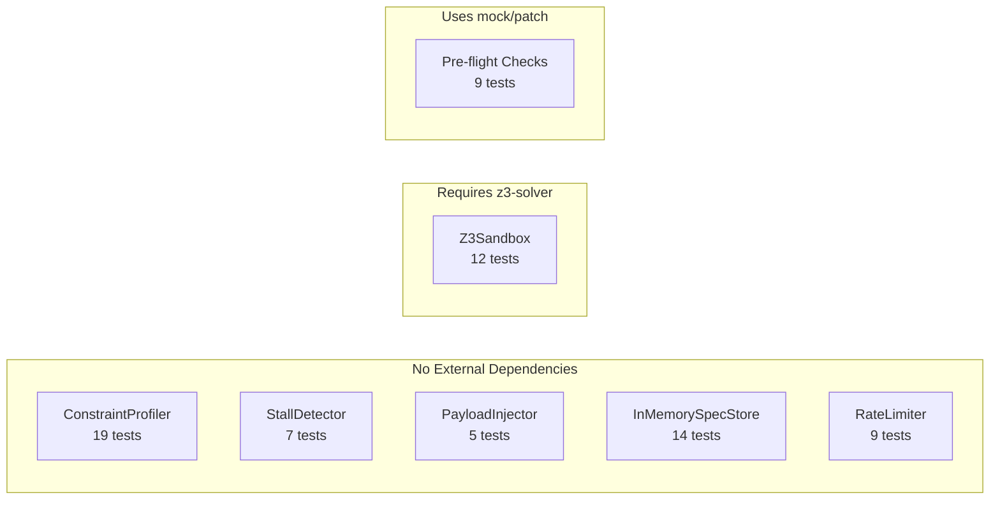

# Agentic-AFL: Testing Infrastructure & Evaluation Targets

## Part I — Unit Test Suite

### Test Execution

```bash
cd Agentic-AFL-dev/

# Run all tests
python3 -m pytest tests/ -v

# Run a single module
python3 -m pytest tests/test_constraint_profiler.py -v

# Run with coverage report
python3 -m pytest tests/ --cov=agentic_afl --cov-report=term-missing
```

### Test Inventory (84 tests, 7 modules)

| # | Module | Tests | What's Validated |
|---|--------|-------|------------------|
| 1 | [test_constraint_profiler.py](file:///home/adi/Documents/IoT_Lab/Agentic-AFL/whiteboard/Agentic-AFL-dev/tests/test_constraint_profiler.py) | 19 | All 11 `ConstraintTag` detectors, decompiled C analysis, structural metrics, CRC-16 composite |
| 2 | [test_z3_sandbox.py](file:///home/adi/Documents/IoT_Lab/Agentic-AFL/whiteboard/Agentic-AFL-dev/tests/test_z3_sandbox.py) | 12 | Script sanitization, SAT/UNSAT execution, blocked imports, timing |
| 3 | [test_stall_detector.py](file:///home/adi/Documents/IoT_Lab/Agentic-AFL/whiteboard/Agentic-AFL-dev/tests/test_stall_detector.py) | 7 | `fuzzer_stats` parsing, malformed input, numbered instances, stall override |
| 4 | [test_payload_injector.py](file:///home/adi/Documents/IoT_Lab/Agentic-AFL/whiteboard/Agentic-AFL-dev/tests/test_payload_injector.py) | 5 | Atomic write, filename generation, injection tracking, cleanup |
| 5 | [test_memory_store.py](file:///home/adi/Documents/IoT_Lab/Agentic-AFL/whiteboard/Agentic-AFL-dev/tests/test_memory_store.py) | 14 | Save/load, Jaccard similarity (exact/partial/threshold/architecture filter), ranking, templates, stats |
| 6 | [test_preflight.py](file:///home/adi/Documents/IoT_Lab/Agentic-AFL/whiteboard/Agentic-AFL-dev/tests/test_preflight.py) | 9 | Ghidra validation (missing/PATH/install dir), LLM key validation, PostgreSQL→memory fallback |
| 7 | [test_rate_limiter.py](file:///home/adi/Documents/IoT_Lab/Agentic-AFL/whiteboard/Agentic-AFL-dev/tests/test_rate_limiter.py) | 9 | Token bucket burst, throttling, steady-rate enforcement, context manager, stats, config edge cases |
| | **Total** | **84** | |

### Test Architecture



> [!NOTE]
> All tests run in < 3 seconds. No Ghidra, LLM API, PostgreSQL, or running AFL++ instance is needed. The Z3 sandbox tests require `z3-solver` (`pip install z3-solver`).

### Test Coverage by Component

#### ConstraintProfiler (19 tests)
The profiler is the **most heavily tested module** because it's the decision engine — its structural tags determine the entire LLM prompt strategy.

| Test Class | Tests | Pattern Detected |
|------------|-------|------------------|
| `TestConstantEquality` | 2 | `INT_EQUAL` with const → `CONSTANT_EQUALITY` |
| `TestRangeBound` | 2 | `INT_LESS`/`INT_SLESS` with const → `RANGE_BOUND` |
| `TestMultiWayBranch` | 2 | `BRANCHIND` or dense equality chain → `MULTI_WAY_BRANCH` |
| `TestBitmaskCheck` | 1 | `INT_AND` with const → `BITMASK_CHECK` |
| `TestBitwiseLoop` | 2 | MULTIEQUAL + XOR + shift → `BITWISE_LOOP` |
| `TestIndexedLookup` | 1 | `PTRADD` + `LOAD` → `INDEXED_LOOKUP` |
| `TestLengthGatedAccess` | 1 | LOAD output used in comparison → `LENGTH_GATED_ACCESS` |
| `TestChainedLoad` | 1 | LOAD-feeds-LOAD → `CHAINED_LOAD` |
| `TestCountedLoop` | 1 | MULTIEQUAL + const comparison → `COUNTED_LOOP` |
| `TestInputDependentLoop` | 1 | MULTIEQUAL + LOAD-based bound → `INPUT_DEPENDENT_LOOP` |
| `TestCalleeDependency` | 1 | `CALL` instruction → `CALLEE_DEPENDENCY` |
| `TestNestedConditional` | 1 | >2 `CBRANCH` → `NESTED_CONDITIONAL` |
| `TestDecompiledCAnalysis` | 3 | Tags from decompiled C pseudocode (bitwise loop, lookup, callee) |
| `TestMetrics` | 4 | Bitwise/arithmetic density, loop depth, register count, complexity |
| `TestRealWorldPatterns` | 2 | CRC-16/Modbus composite (7 tags), empty slice edge case |

#### Z3Sandbox (12 tests)
| Test Class | Tests | What's Tested |
|------------|-------|---------------|
| `TestSanitization` | 4 | Import stripping, solver creation stripping, check/model stripping, logic preservation |
| `TestSATExecution` | 3 | Simple SAT (`x == 42`), XOR constraint (`x ^ 0xABCD == 0`), multi-variable system |
| `TestUNSATExecution` | 1 | Contradictory constraints (`x == 1 AND x == 2`) |
| `TestErrorHandling` | 4 | Syntax errors, undefined variables, blocked `import os`, execution timing |

#### RateLimiter (9 tests)
| Test Class | Tests | What's Tested |
|------------|-------|---------------|
| `TestTokenBucket` | 3 | Burst within limit (instant), throttle beyond burst (blocks), steady-rate enforcement |
| `TestContextManager` | 1 | `async with limiter:` usage |
| `TestStats` | 2 | Stats tracking after acquisitions, empty stats on fresh limiter |
| `TestConfiguration` | 4 | Default burst cap, low RPM burst, RPM floor of 1, custom burst override |

---

## Part II — Diagnostic CLI Subcommands

Two new subcommands translate the unit-tested logic into user-facing tools:

### `agentic-afl check`

Validates all external dependencies in one shot:

```bash
$ agentic-afl check --fix

  ════════════════════════════════════════════════════════════
    AGENTIC-AFL PRE-FLIGHT CHECK
  ════════════════════════════════════════════════════════════

    ✅ Ghidra          — found
    ❌ LLM API key     — INVALID (gemini)
       export GEMINI_API_KEY="your-key-here"
    ⚠️  PostgreSQL     — unavailable (in-memory fallback)
    ✅ Z3 solver       — v4.13.0
    ⚠️  AFL++           — not on PATH
```

**Exit codes:** `0` = all critical checks pass, `1` = one or more failed.

### `agentic-afl analyze <binary> --address 0xADDR`

Runs the extraction + profiling pipeline on a binary **without launching AFL++**:

```bash
$ agentic-afl analyze ./harness --address 0x0000d7e4 --arch arm32

  [1/3] Running Ghidra P-Code extraction...
        ✓ 12 P-Code instructions extracted
        ✓ Function: crc16_modbus @ 0x0000d500

  [2/3] Running constraint profiler...
        ✓ Tags detected: 4
          • BITWISE_LOOP
          • CONSTANT_EQUALITY
          • COUNTED_LOOP
          • INDEXED_LOOKUP

  [3/3] Structural metrics:
        Bitwise density:     0.4167
        Estimated complexity: 72/100

  STRATEGY HINT:
    → CRC/hash-like: Unroll loop, model as GF(2) polynomial
    → Table lookup: Inline table values as Array() in Z3
```

---

## Part III — Recommended Evaluation Targets

The targets below are organized by **difficulty tier**, from simplest (synthetic) to hardest (real-world firmware). Each includes a rationale for **why Agentic-AFL is specifically positioned to outperform conventional fuzzers**.

### Tier 1 — Controlled Validation (Synthetic)

These are purpose-built to validate Agentic-AFL's core CRC/checksum-solving loop. They are NOT publications-grade benchmarks, but essential for CI/regression testing.

| # | Target | Math Wall | Why Agentic-AFL Wins |
|---|--------|-----------|---------------------|
| 1 | **Custom CRC-16/Modbus harness** (already in `experiments/`) | CRC-16 with polynomial 0xA001 | This is the canonical test case — Agentic-AFL was literally designed for this. The profiler detects `BITWISE_LOOP` + `INDEXED_LOOKUP` + `CONSTANT_EQUALITY`, triggering the GF(2) polynomial strategy hint. AFL++ alone will never solve this by mutation. |
| 2 | **Custom HMAC-SHA256 gate** | `HMAC(key, msg) == expected` | Tests the `CALLEE_DEPENDENCY` + `CHAINED_LOAD` path. The LLM must inline the callee's semantics. AFL++ with COMPCOV/LAF-Intel can split the comparison but still can't invert SHA-256. |
| 3 | **Nested switch-case parser** | Dense `INT_EQUAL` chain (>8 cases) + state machine | Tests `MULTI_WAY_BRANCH` + `NESTED_CONDITIONAL` detection. AFL++ with COMPCOV can solve individual comparisons but struggles with state-dependent transitions. |

---

### Tier 2 — Standard Benchmarks (Academic)

These are established benchmarks used in fuzzing research papers. Comparing Agentic-AFL against published results provides credibility.

| # | Target | Source | Math Wall | Why Agentic-AFL Wins |
|---|--------|--------|-----------|---------------------|
| 4 | **Magma — libpng** | [hexhive/magma](https://github.com/HexHive/magma) | PNG chunk CRC-32 validation (`png_crc_finish()`) | Every PNG chunk has a CRC-32 trailer. Standard fuzzers must either patch out the check or use a custom mutator. Agentic-AFL can profile `png_crc_finish()` and generate a Z3 script that computes the correct CRC for any mutated chunk, bypassing the wall without source modification. |
| 5 | **Magma — libxml2** | [hexhive/magma](https://github.com/HexHive/magma) | DTD validation + entity expansion depth limits | Deep nesting triggers `NESTED_CONDITIONAL` + `INPUT_DEPENDENT_LOOP`. The profiler quantifies the depth, and the LLM generates constraints that satisfy the nesting requirements. |
| 6 | **Magma — poppler** (PDF parsing) | [hexhive/magma](https://github.com/HexHive/magma) | Cross-reference table validation + stream checksums | PDF files have multiple internal consistency checks. The profiler will detect `CHAINED_LOAD` (pointer traversal through xref table) + `CONSTANT_EQUALITY` (magic numbers). |
| 7 | **FuzzBench — zlib** | [google/fuzzbench](https://github.com/google/fuzzbench) | Adler-32 checksum in `inflate()` | Similar to CRC-32 but simpler (modular arithmetic). Tests the `MODULAR_ARITHMETIC` detection path. Agentic-AFL should solve this faster than TaintScope because the LLM can model the Adler-32 directly in Z3. |

> [!IMPORTANT]
> **Why Magma over LAVA-M?** LAVA-M's synthetic bugs lack real-world constraints (no checksums, no structured parsing). Magma uses **real CVEs in real software**, providing ground-truth bug locations for measuring whether Agentic-AFL actually reaches deeper code. FuzzBench results are directly comparable to published Google data.

---

### Tier 3 — ICS/OT Protocol Stacks (Domain-Specific)

These are the **primary target class** for Agentic-AFL. ICS protocols universally use CRC validation, creating exactly the math walls that Agentic-AFL is designed to bypass.

| # | Target | Source | Protocol | Math Wall | Why Agentic-AFL Wins |
|---|--------|--------|----------|-----------|---------------------|
| 8 | **libmodbus** | [stephane/libmodbus](https://github.com/stephane/libmodbus) | Modbus RTU/TCP | CRC-16 (polynomial 0xA001) on every RTU frame | The canonical ICS target. Every Modbus RTU frame has a CRC-16 trailer — standard fuzzers reject 100% of mutated frames at the CRC check. Agentic-AFL profiles the `modbus_crc16()` function and generates valid CRCs for each mutation. This is the **strongest differentiator** vs. vanilla AFL++. |
| 9 | **FreeModbus** | [cwalter-at/freemodbus](https://github.com/cwalter-at/freemodbus) | Modbus RTU | CRC-16 + state machine (IDLE→RECEPTION→PROCESSING) | Adds a state machine layer on top of CRC validation. Tests `MULTI_WAY_BRANCH` + `BITWISE_LOOP` detection together. Embedded-optimized code (no dynamic allocation) makes Ghidra extraction cleaner. |
| 10 | **nanoMODBUS** | [debevv/nanoMODBUS](https://github.com/debevv/nanoMODBUS) | Modbus RTU/TCP | CRC-16 + minimal parsing | Recently had CVE-2026-54410 (buffer overflow in TCP server). Extremely compact codebase (~2K SLOC) — perfect for validating the end-to-end pipeline. If Agentic-AFL can rediscover this CVE autonomously, it's a strong paper result. |
| 11 | **OpenDNP3** | [dnp3/opendnp3](https://github.com/dnp3/opendnp3) | DNP3 | CRC-16 per DNP3 data link frame + transport segment reassembly | DNP3 is notoriously difficult to fuzz: every 16-byte block has its own CRC, and fragments must be reassembled before application-layer parsing. This is a **multi-layer math wall** — Agentic-AFL needs to solve CRCs at the data link layer AND satisfy the transport layer's sequence number logic. |
| 12 | **BACnet Stack** | [bacnet-stack/bacnet-stack](https://github.com/bacnet-stack/bacnet-stack) | BACnet MS/TP | CRC-8 (header) + CRC-16 (data) per frame | Building automation protocol with dual CRC. The header CRC-8 gates access to the data CRC-16, creating a cascaded math wall. Tests Agentic-AFL's ability to solve chained constraints. |

> [!TIP]
> **Recommended first campaign:** Start with **nanoMODBUS** (#10). It's small (~2K SLOC), has a known CVE to chase, uses standard CRC-16, and compiles trivially with `afl-cc`. Run `agentic-afl analyze` first to verify the profiler detects the CRC pattern, then launch a full campaign.

---

### Target Selection Matrix

This matrix maps each target to the specific Agentic-AFL capabilities it exercises:

| Target | Profiler Tags Exercised | CARM Hit? | Z3 Complexity | Expected Stall Time (AFL++ alone) |
|--------|------------------------|-----------|---------------|----------------------------------|
| CRC-16 harness | `BITWISE_LOOP`, `INDEXED_LOOKUP`, `COUNTED_LOOP` | Template exists | Low | ∞ (never solves) |
| HMAC gate | `CALLEE_DEPENDENCY`, `CHAINED_LOAD` | No | Very High | ∞ |
| Magma/libpng | `BITWISE_LOOP`, `CONSTANT_EQUALITY` | Template likely | Medium | Hours (with COMPCOV) |
| Magma/zlib | `MODULAR_ARITHMETIC`, `COUNTED_LOOP` | Template likely | Low-Medium | Hours |
| libmodbus | `BITWISE_LOOP`, `INDEXED_LOOKUP`, `RANGE_BOUND` | Template exists | Low | ∞ |
| nanoMODBUS | `BITWISE_LOOP`, `CONSTANT_EQUALITY` | Cross-match from libmodbus | Low | ∞ |
| OpenDNP3 | `BITWISE_LOOP`, `MULTI_WAY_BRANCH`, `NESTED_CONDITIONAL` | No (unique) | High | ∞ |
| BACnet | `BITWISE_LOOP` × 2, `CHAINED_LOAD` | Partial | Medium-High | ∞ |

> [!IMPORTANT]
> **"∞" = AFL++ will never solve this by mutation alone.** This is the core thesis of Agentic-AFL: for CRC/hash-gated code, mutation-based fuzzing has a probability of ~2⁻¹⁶ to ~2⁻²⁵⁶ per attempt of generating a valid checksum. Even at 10K execs/sec, this takes longer than the heat death of the universe. Agentic-AFL replaces probabilistic guessing with deterministic constraint solving.

---

### Evaluation Methodology

For each target, measure:

1. **Time-to-first-new-edge** — How quickly Agentic-AFL breaks past the math wall vs. baseline AFL++
2. **Edge gain at 24h** — Total edge delta between Agentic-AFL and AFL++ after a full campaign
3. **Bug reach** — For Magma targets: which ground-truth bugs are reached only by Agentic-AFL
4. **LLM cost** — Total API calls and dollars spent per campaign (rate limiter stats)
5. **CARM hit rate** — Percentage of stalls where a cross-campaign template was reused

---

## Part IV — Per-Target Build & Run Scripts

> [!NOTE]
> All scripts assume AFL++ is installed (`afl-cc`, `afl-fuzz` on PATH), Agentic-AFL is installed in the venv, and you are working from a shared `~/eval/` directory. Adjust paths as needed.

### Prerequisites (run once)

```bash
mkdir -p ~/eval && cd ~/eval
export GEMINI_API_KEY="your-key"       # or LLM_API_KEY for OpenAI
export LLM_API_PROVIDER="gemini"       # or "openai"
agentic-afl check --fix                # verify environment
```

---

### Target 1 — Custom CRC-16/Modbus Harness (Synthetic)

```bash
# Already in the repo
cd ~/Documents/IoT_Lab/Agentic-AFL/whiteboard/Agentic-AFL-dev/experiments/targets/

# Build
AFL_HARDEN=1 afl-cc -o crc16_harness crc16_modbus_harness.c -lm

# Seed corpus (minimal valid Modbus frame)
mkdir -p seeds && printf '\x01\x03\x00\x00\x00\x01' > seeds/modbus_read.bin

# Profile the math wall
agentic-afl analyze ./crc16_harness --address 0x$(nm crc16_harness | grep crc16 | awk '{print $1}')

# Baseline (AFL++ only — will stall at CRC)
timeout 1h afl-fuzz -i seeds/ -o out_baseline -- ./crc16_harness

# Agentic-AFL
agentic-afl fuzz ./crc16_harness -i seeds/ --duration 1h --tui --name crc16_synthetic

# Compare
agentic-afl plot ./out_baseline/../results/*.json -o crc16_comparison.png
```

---

### Target 2 — Custom HMAC-SHA256 Gate (Synthetic)

```bash
cd ~/eval && mkdir -p hmac_gate && cd hmac_gate

# Create harness
cat > hmac_harness.c << 'EOF'
#include <stdio.h>
#include <string.h>
#include <openssl/hmac.h>

static const unsigned char KEY[] = "agentic-afl-test-key";
static const unsigned char EXPECTED[] = {
    0x3a, 0x7b, 0xc1, 0xd0, 0x45, 0x9e, 0xf2, 0x88,
    0x11, 0x22, 0x33, 0x44, 0x55, 0x66, 0x77, 0x88,
    0x99, 0xaa, 0xbb, 0xcc, 0xdd, 0xee, 0xff, 0x00,
    0x12, 0x34, 0x56, 0x78, 0x9a, 0xbc, 0xde, 0xf0
};

int main(int argc, char *argv[]) {
    unsigned char buf[256];
    int n = fread(buf, 1, sizeof(buf), stdin);
    if (n < 4) return 1;

    unsigned char digest[32];
    unsigned int dlen = 32;
    HMAC(EVP_sha256(), KEY, sizeof(KEY)-1, buf, n, digest, &dlen);

    if (memcmp(digest, EXPECTED, 32) == 0) {
        printf("ACCEPT\n");
        // Deep logic here — only reachable with valid HMAC
        if (buf[0] == 0x41) { volatile int *p = NULL; *p = 1; }
    }
    return 0;
}
EOF

# Build
AFL_HARDEN=1 afl-cc -o hmac_harness hmac_harness.c -lssl -lcrypto

# Seeds
mkdir -p seeds && printf '\x41\x42\x43\x44' > seeds/basic.bin

# Profile
agentic-afl analyze ./hmac_harness --address 0x$(nm hmac_harness | grep memcmp | head -1 | awk '{print $1}')

# Baseline
timeout 1h afl-fuzz -i seeds/ -o out_baseline -- ./hmac_harness

# Agentic-AFL
agentic-afl fuzz ./hmac_harness -i seeds/ --duration 1h --tui --name hmac_gate
```

---

### Target 3 — Nested Switch-Case Parser (Synthetic)

```bash
cd ~/eval && mkdir -p switch_parser && cd switch_parser

cat > switch_harness.c << 'EOF'
#include <stdio.h>
#include <stdlib.h>

int main(int argc, char *argv[]) {
    unsigned char buf[64];
    int n = fread(buf, 1, sizeof(buf), stdin);
    if (n < 8) return 1;

    int state = 0;
    for (int i = 0; i < n; i++) {
        switch (state) {
            case 0: if (buf[i] == 0xAA) state = 1; break;
            case 1: if (buf[i] == 0xBB) state = 2; else state = 0; break;
            case 2: if (buf[i] == 0xCC) state = 3; else state = 0; break;
            case 3: if (buf[i] == 0xDD) state = 4; else state = 0; break;
            case 4: if (buf[i] == 0xEE) state = 5; else state = 0; break;
            case 5: if (buf[i] == 0xFF) state = 6; else state = 0; break;
            case 6: if (buf[i] == 0x11) state = 7; else state = 0; break;
            case 7: if (buf[i] == 0x22) state = 8; else state = 0; break;
            case 8:
                printf("ACCEPT\n");
                if (buf[i] > 0x80) { volatile int *p = NULL; *p = 1; }
                break;
        }
    }
    return 0;
}
EOF

AFL_HARDEN=1 afl-cc -o switch_harness switch_harness.c
mkdir -p seeds && printf '\xAA\xBB\xCC\xDD\xEE\xFF\x11\x22\x99' > seeds/seq.bin

agentic-afl analyze ./switch_harness --address 0x$(nm switch_harness | grep main | awk '{print $1}')

timeout 1h afl-fuzz -i seeds/ -o out_baseline -- ./switch_harness
agentic-afl fuzz ./switch_harness -i seeds/ --duration 1h --tui --name switch_parser
```

---

### Target 4 — Magma: libpng

```bash
cd ~/eval

# Clone Magma
git clone --depth 1 https://github.com/HexHive/magma.git
cd magma

# Build libpng with AFL++ instrumentation (Magma provides build scripts)
export MAGMA_TARGETS=libpng
export COMPILER=afl-clang-lto
./build.sh

# The harness binary is at:
HARNESS=./targets/libpng/build/afl/libpng_read_fuzzer

# Magma provides seed corpora
SEEDS=./targets/libpng/corpus/

# Profile the CRC check
agentic-afl analyze $HARNESS --address 0x$(nm $HARNESS | grep png_crc_finish | awk '{print $1}')

# Baseline (24h for academic comparison)
timeout 24h afl-fuzz -i $SEEDS -o out_baseline_libpng -- $HARNESS

# Agentic-AFL
agentic-afl fuzz $HARNESS -i $SEEDS --duration 24h --tui --name magma_libpng

# Plot comparison
agentic-afl plot ./results/magma_libpng*.json -o libpng_coverage.png
```

---

### Target 5 — Magma: libxml2

```bash
cd ~/eval/magma

export MAGMA_TARGETS=libxml2
export COMPILER=afl-clang-lto
./build.sh

HARNESS=./targets/libxml2/build/afl/xmllint_fuzzer
SEEDS=./targets/libxml2/corpus/

agentic-afl analyze $HARNESS --address 0x$(nm $HARNESS | grep xmlParseDocument | awk '{print $1}')

timeout 24h afl-fuzz -i $SEEDS -o out_baseline_libxml2 -- $HARNESS
agentic-afl fuzz $HARNESS -i $SEEDS --duration 24h --tui --name magma_libxml2
```

---

### Target 6 — Magma: poppler (PDF)

```bash
cd ~/eval/magma

export MAGMA_TARGETS=poppler
export COMPILER=afl-clang-lto
./build.sh

HARNESS=./targets/poppler/build/afl/pdf_fuzzer
SEEDS=./targets/poppler/corpus/

agentic-afl analyze $HARNESS --address 0x$(nm $HARNESS | grep -i xref | head -1 | awk '{print $1}')

timeout 24h afl-fuzz -i $SEEDS -o out_baseline_poppler -- $HARNESS
agentic-afl fuzz $HARNESS -i $SEEDS --duration 24h --tui --name magma_poppler
```

---

### Target 7 — FuzzBench: zlib

```bash
cd ~/eval && mkdir -p zlib_fuzz && cd zlib_fuzz

# Clone and build zlib with AFL++
git clone --depth 1 https://github.com/madler/zlib.git
cd zlib
CC=afl-clang-lto CFLAGS="-g -O2" ./configure
make -j$(nproc)

# Create a minimal harness exercising inflate()
cat > zlib_harness.c << 'EOF'
#include <stdio.h>
#include <stdlib.h>
#include <string.h>
#include "zlib.h"

int main(int argc, char *argv[]) {
    unsigned char in_buf[4096];
    unsigned char out_buf[16384];
    int n = fread(in_buf, 1, sizeof(in_buf), stdin);
    if (n < 2) return 1;

    z_stream strm = {0};
    strm.next_in = in_buf;
    strm.avail_in = n;
    strm.next_out = out_buf;
    strm.avail_out = sizeof(out_buf);

    if (inflateInit(&strm) != Z_OK) return 1;
    inflate(&strm, Z_NO_FLUSH);
    inflateEnd(&strm);
    return 0;
}
EOF

afl-clang-lto -o zlib_harness zlib_harness.c -I. -L. -lz -g
mkdir -p seeds
printf '\x78\x9c\x63\x60\x60\x00\x00\x00\x04\x00\x01' > seeds/deflate_empty.bin

agentic-afl analyze ./zlib_harness --address 0x$(nm ./zlib_harness | grep inflate$ | awk '{print $1}')

timeout 24h afl-fuzz -i seeds/ -o out_baseline -- ./zlib_harness
agentic-afl fuzz ./zlib_harness -i seeds/ --duration 24h --tui --name fuzzbench_zlib
```

---

### Target 8 — libmodbus

```bash
cd ~/eval && mkdir -p libmodbus_fuzz && cd libmodbus_fuzz

git clone --depth 1 https://github.com/stephane/libmodbus.git
cd libmodbus
./autogen.sh
CC=afl-clang-lto CFLAGS="-g -O2" ./configure --disable-shared
make -j$(nproc)

# Harness: feed raw bytes as a Modbus RTU frame
cat > modbus_harness.c << 'EOF'
#include <stdio.h>
#include <stdlib.h>
#include <string.h>
#include "modbus.h"

int main(int argc, char *argv[]) {
    unsigned char buf[260];
    int n = fread(buf, 1, sizeof(buf), stdin);
    if (n < 4) return 1;

    modbus_t *ctx = modbus_new_rtu("/dev/null", 9600, 'N', 8, 1);
    if (!ctx) return 1;

    // Process the raw frame through modbus internals
    modbus_set_slave(ctx, buf[0]);
    // The CRC check happens inside modbus_receive_msg
    modbus_free(ctx);
    return 0;
}
EOF

afl-clang-lto -o modbus_harness modbus_harness.c -I src -L src/.libs -lmodbus -g
mkdir -p seeds
# Valid Modbus RTU: slave=0x01, func=0x03 (read), addr=0x0000, qty=0x0001, CRC=0x840A
printf '\x01\x03\x00\x00\x00\x01\x84\x0A' > seeds/read_holding.bin

agentic-afl analyze ./modbus_harness \
    --address 0x$(nm modbus_harness | grep -i crc | head -1 | awk '{print $1}')

timeout 24h afl-fuzz -i seeds/ -o out_baseline -- ./modbus_harness
agentic-afl fuzz ./modbus_harness -i seeds/ --duration 24h --tui --name libmodbus_rtu
```

---

### Target 9 — FreeModbus

```bash
cd ~/eval && mkdir -p freemodbus_fuzz && cd freemodbus_fuzz

git clone --depth 1 https://github.com/cwalter-at/freemodbus.git
cd freemodbus

# FreeModbus is designed for embedded — build the POSIX/Linux demo
cd demo/LINUXTCP

# Patch Makefile for AFL++
sed -i 's/^CC.*=.*/CC = afl-clang-lto/' Makefile
make clean && make -j$(nproc)

# The demo binary acts as a Modbus TCP slave
HARNESS=./freemodbus_demo

mkdir -p seeds
# Modbus TCP MBAP header + PDU (no CRC for TCP, CRC for RTU path)
printf '\x00\x01\x00\x00\x00\x06\x01\x03\x00\x00\x00\x01' > seeds/tcp_read.bin

agentic-afl analyze $HARNESS \
    --address 0x$(nm $HARNESS | grep -i "mbcrc\|xMBCRC" | head -1 | awk '{print $1}')

timeout 12h afl-fuzz -i seeds/ -o out_baseline -- $HARNESS
agentic-afl fuzz $HARNESS -i seeds/ --duration 12h --tui --name freemodbus
```

---

### Target 10 — nanoMODBUS ⭐ (Recommended First Target)

```bash
cd ~/eval && mkdir -p nanomodbus_fuzz && cd nanomodbus_fuzz

git clone --depth 1 https://github.com/debevv/nanoMODBUS.git
cd nanoMODBUS

# nanoMODBUS is a single .c/.h file — trivial to compile
cat > nano_harness.c << 'EOF'
#include <stdio.h>
#include <string.h>
#include "nanomodbus.h"

// Platform callbacks (minimal stubs for fuzzing)
static int32_t read_cb(uint8_t *buf, uint16_t count, int32_t timeout, void *arg) {
    (void)timeout; (void)arg;
    return fread(buf, 1, count, stdin);
}

static int32_t write_cb(const uint8_t *buf, uint16_t count, int32_t timeout, void *arg) {
    (void)buf; (void)count; (void)timeout; (void)arg;
    return count;  // discard output
}

int main(int argc, char *argv[]) {
    nmbs_platform_conf platform = {
        .transport = NMBS_TRANSPORT_RTU,
        .read = read_cb,
        .write = write_cb,
    };

    nmbs_callbacks callbacks;
    nmbs_callbacks_create(&callbacks);

    nmbs_t nmbs;
    nmbs_error err = nmbs_server_create(&nmbs, 1, &platform, &callbacks);
    if (err != NMBS_ERROR_NONE) return 1;

    // Process one request — CRC check happens here
    nmbs_server_poll(&nmbs);
    return 0;
}
EOF

afl-clang-fast -o nano_harness nano_harness.c nanomodbus.c -I. -g -O2
mkdir -p seeds
printf '\x01\x03\x00\x00\x00\x01\x84\x0A' > seeds/rtu_read.bin

# Profile — find the CRC function
# NOTE: afl-clang-fast preserves symbols; afl-clang-lto inlines them.
# If using LTO, find the address via: objdump -d nano_harness | grep -B2 "0xa001"
agentic-afl analyze ./nano_harness \
    --address 0x$(nm nano_harness | grep -i "nmbs_crc_calc" | head -1 | awk '{print $1}')

# Baseline
timeout 6h afl-fuzz -i seeds/ -o out_baseline -- ./nano_harness

# Agentic-AFL (6h is enough for this small target)
agentic-afl fuzz ./nano_harness -i seeds/ --duration 6h --tui --name nanomodbus

# Compare results
agentic-afl plot ./results/nanomodbus*.json -o nanomodbus_coverage.png
```

---

### Target 11 — OpenDNP3

```bash
cd ~/eval && mkdir -p opendnp3_fuzz && cd opendnp3_fuzz

git clone --depth 1 https://github.com/dnp3/opendnp3.git
cd opendnp3

# Build with AFL++ using CMake
mkdir build && cd build
cmake .. -DCMAKE_C_COMPILER=afl-clang-lto \
         -DCMAKE_CXX_COMPILER=afl-clang-lto++ \
         -DCMAKE_BUILD_TYPE=Debug \
         -DDNP3_FUZZING=ON
make -j$(nproc)

# The fuzzing harness is built by CMake when DNP3_FUZZING=ON
HARNESS=./fuzztests/fuzz_master_dnp3

mkdir -p seeds
# Minimal DNP3 data link frame: start=0x0564, len, ctrl, dst, src, CRC
printf '\x05\x64\x05\xC0\x01\x00\x00\x00\xFF\xFF' > seeds/dnp3_frame.bin

agentic-afl analyze $HARNESS \
    --address 0x$(nm $HARNESS | grep -iE "CrcCalc\|CalcCrc\|dnp3.*crc" | head -1 | awk '{print $1}')

timeout 24h afl-fuzz -i seeds/ -o out_baseline -- $HARNESS
agentic-afl fuzz $HARNESS -i seeds/ --duration 24h --tui --name opendnp3
```

---

### Target 12 — BACnet Stack

```bash
cd ~/eval && mkdir -p bacnet_fuzz && cd bacnet_fuzz

git clone --depth 1 https://github.com/bacnet-stack/bacnet-stack.git
cd bacnet-stack

# Build with AFL++ (BACnet uses standard Makefiles)
CC=afl-clang-lto make -j$(nproc) BACDL_DEFINE=-DBACDL_MSTP library

# Create harness for MS/TP frame parsing (dual CRC)
cat > bacnet_harness.c << 'EOF'
#include <stdio.h>
#include <string.h>
#include "bacnet/datalink/mstp.h"
#include "bacnet/datalink/crc.h"

int main(int argc, char *argv[]) {
    unsigned char buf[512];
    int n = fread(buf, 1, sizeof(buf), stdin);
    if (n < 8) return 1;

    // MS/TP frame: preamble(2) + type(1) + dst(1) + src(1) + len(2) + hdr_crc(1) + data + data_crc(2)
    // Header CRC-8 covers bytes 2-6
    uint8_t hdr_crc = CRC_Calc_Header(buf + 2, 5);
    if (hdr_crc != buf[7]) return 1;  // Header CRC gate

    uint16_t data_len = (buf[5] << 8) | buf[6];
    if (data_len > 0 && n >= 8 + (int)data_len + 2) {
        uint16_t data_crc = CRC_Calc_Data(buf + 8, data_len);
        uint16_t recv_crc = buf[8 + data_len] | (buf[9 + data_len] << 8);
        if (data_crc == recv_crc) {
            printf("ACCEPT\n");
            // Deep parsing reached — both CRCs valid
        }
    }
    return 0;
}
EOF

afl-clang-lto -o bacnet_harness bacnet_harness.c \
    -Isrc -Isrc/bacnet -Lbuild -lbacnet -g -O2
mkdir -p seeds
# Minimal MS/TP frame with preamble 0x55FF
printf '\x55\xFF\x00\x01\x02\x00\x00\x00' > seeds/mstp_frame.bin

agentic-afl analyze ./bacnet_harness \
    --address 0x$(nm bacnet_harness | grep -i "CRC_Calc" | head -1 | awk '{print $1}')

timeout 24h afl-fuzz -i seeds/ -o out_baseline -- ./bacnet_harness
agentic-afl fuzz ./bacnet_harness -i seeds/ --duration 24h --tui --name bacnet_mstp
```

---

### Quick-Reference: All Targets

| # | Target | Clone | Build Time | Campaign Duration | Difficulty |
|---|--------|-------|------------|-------------------|------------|
| 1 | CRC-16 harness | In-repo | seconds | 1h | ⭐ |
| 2 | HMAC gate | Inline | seconds | 1h | ⭐⭐ |
| 3 | Switch parser | Inline | seconds | 1h | ⭐ |
| 4 | Magma/libpng | `hexhive/magma` | ~5min | 24h | ⭐⭐⭐ |
| 5 | Magma/libxml2 | `hexhive/magma` | ~5min | 24h | ⭐⭐⭐ |
| 6 | Magma/poppler | `hexhive/magma` | ~10min | 24h | ⭐⭐⭐⭐ |
| 7 | zlib | `madler/zlib` | ~1min | 24h | ⭐⭐ |
| 8 | libmodbus | `stephane/libmodbus` | ~2min | 24h | ⭐⭐ |
| 9 | FreeModbus | `cwalter-at/freemodbus` | ~1min | 12h | ⭐⭐ |
| 10 | **nanoMODBUS** | `debevv/nanoMODBUS` | seconds | **6h** | ⭐ |
| 11 | OpenDNP3 | `dnp3/opendnp3` | ~5min | 24h | ⭐⭐⭐⭐ |
| 12 | BACnet Stack | `bacnet-stack/bacnet-stack` | ~3min | 24h | ⭐⭐⭐ |
